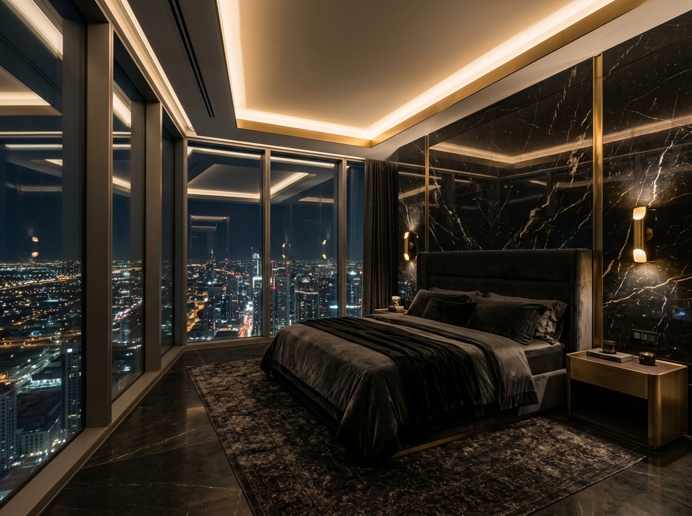
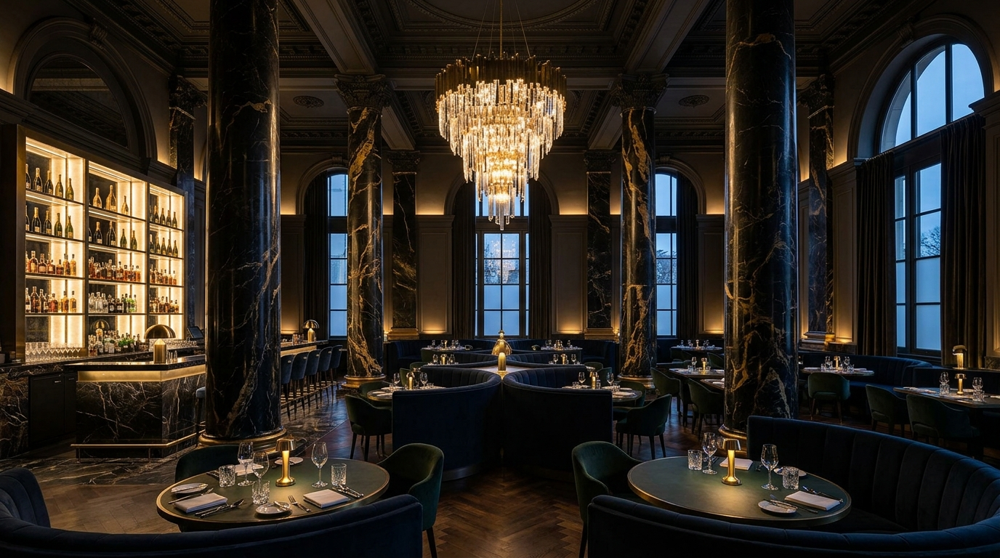

# L'Obsidienne Palace · DEMO

**English** · [繁體中文](./README.zh-TW.md)

> **DEMO / fictional hotel showcase** — not a real booking service.  
> An interactive luxury-hotel experience page: Nero Marquina marble mood, a live Three.js monolith, and scroll-driven GSAP · ScrollTrigger motion.

Search engines and crawlers are blocked (`robots.txt`, `noindex`, `X-Robots-Tag`).

<p align="center">
  
</p>

<p align="center">
  <a href="https://github.com/ReiKama414/noir-obsidian-hotel">Star</a>
  ·
  <a href="#quick-start">Quick start</a>
  ·
  <a href="#license">License</a>
</p>

---

## Why

A hotel landing page should feel like walking through stone and light, not a dashboard of cards. The 3D monolith stays in the background; scroll and a few studio controls tell the rest of the story.

---

## Highlights

- **Brand-first hero** — Full-bleed WebGL stage, large wordmark, one line of copy, clear CTAs
- **Scroll choreography** — Intro pin and word scrub, suite reveals, image parallax, page progress
- **Linked 3D** — A scrub timeline moves, rotates, and gently explodes the monolith as you scroll
- **Marble atelier** — Hotspots, material presets, explode / orbit inspect tied to the scene API
- **Concierge booking** — Suite filters, add-ons, live totals, and a generated pass code in-browser

---

## Tech stack

| Layer | Choice |
| --- | --- |
| Markup | HTML |
| Style | Custom CSS |
| 3D | Three.js (r128, CDN) |
| Motion | GSAP 3.12 · ScrollTrigger (CDN) |
| App logic | Vanilla JavaScript |
| Fonts | Cormorant Garamond · Noto Sans TC · Noto Serif TC |

No build step and no backend. Booking math and the pass modal stay on the client.

---

## Quick start

Serve the project root with any static server:

```bash
npx serve -l 5173 .
```

Open [localhost:5173](http://localhost:5173/).

| Command | Purpose |
| --- | --- |
| `npx serve -l 5173 .` | Static preview on port 5173 |

There is no install script, account, or API key.

---

## Usage

| Action | Behavior |
| --- | --- |
| Scroll | Hero fades; intro pins; suites and dining animate; the monolith follows a scrub timeline |
| Suite filters | Show all, penthouse, pool, or bath suites |
| Suite detail / book | Open the modal or jump to the reservation form |
| Atelier hotspots | Update the spec panel and camera focus on the monolith |
| Material / explode / orbit | Switch marble themes, explode geometry, or drag to inspect (orbit enables canvas pointer events) |
| Reservation | Validate name and date, total suites and add-ons, open a pass modal; Escape or Back closes overlays first |

---

## Project structure

```text
noir-obsidian-hotel/
├── index.html
├── 404.html
├── privacy.html
├── terms.html
├── robots.txt
├── vercel.json
├── css/style.css
├── js/
│   ├── i18n.js
│   ├── three-scene.js
│   ├── gsap-animations.js
│   └── app.js
├── assets/images/
├── LICENSE
├── README.md
└── README.zh-TW.md
```

---

## Screenshots

| Hero mood | Dining |
| --- | --- |
|  |  |

---

## Third-party notices

| Item | Notes |
| --- | --- |
| Three.js · GSAP · ScrollTrigger | Loaded from cdnjs; each keeps its own license |
| Google Fonts | Network load with local fallbacks when offline |
| Suite / dining images | Project assets under this repository’s rights policy |

---

## Links

| | |
| --- | --- |
| Repository | [noir-obsidian-hotel](https://github.com/ReiKama414/noir-obsidian-hotel) |
| Full license text | [LICENSE](./LICENSE) |

---

## License

MIT License — see [LICENSE](./LICENSE).

---

<sub>L'Obsidienne Palace · DEMO · MIT</sub>
