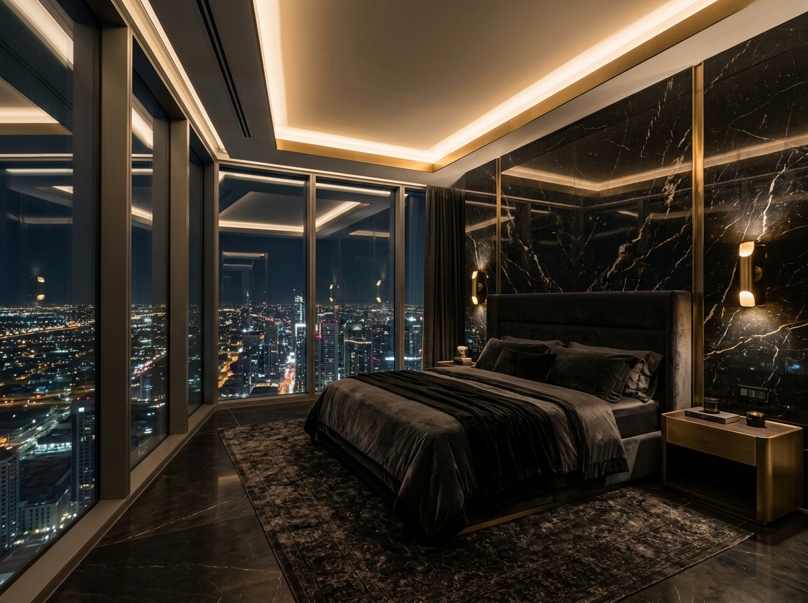
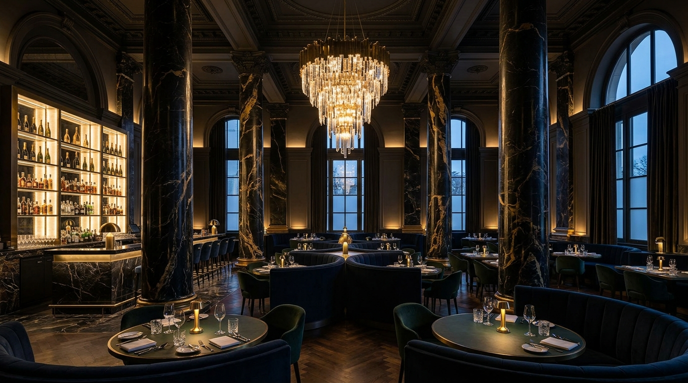

# L'Obsidienne Palace · DEMO

[English](./README.md) · **繁體中文**

> **DEMO／虛構旅館展示** — 不可真實預訂  
> **互動式奢華旅館體驗頁**：Nero Marquina 石材氣氛、即時 Three.js 黑曜結構，以及 GSAP · ScrollTrigger 滾動編排

已阻擋搜尋引擎與爬蟲（`robots.txt`、`noindex`、`X-Robots-Tag`）

<p align="center">
  
</p>

<p align="center">
  <a href="https://github.com/ReiKama414/noir-obsidian-hotel">Star</a>
  ·
  <a href="#快速開始">快速開始</a>
  ·
  <a href="#license--授權">授權</a>
</p>

---

## 為什麼做

旅館首屏該像走進石材與光線，而不是一排儀表板卡片。3D 結構留在背景，用滾動與少量工藝控制把故事說完

---

## 亮點

- **品牌優先的 Hero** — 全幅 WebGL、大字品牌、一句說明與清楚 CTA
- **滾動編排** — Intro 釘住與逐字 scrub、套房揭示、圖片視差、頁面進度條
- **與 3D 連動** — scrub timeline 隨滾動移動、旋轉並輕微解構黑曜結構
- **石材工藝區** — 熱點、材質預設、解構／近距鑑賞對應場景 API
- **私人禮賓預訂** — 套房篩選、加購、即時總額，以及瀏覽器內產生的憑證碼

---

## 技術棧

| 層級 | 選用 |
| --- | --- |
| 結構 | HTML |
| 樣式 | 自訂 CSS |
| 3D | Three.js（r128，CDN） |
| 動態 | GSAP 3.12 · ScrollTrigger（CDN） |
| 邏輯 | 原生 JavaScript |
| 字體 | Cormorant Garamond · Noto Sans TC · Noto Serif TC |

無建置步驟、無後端。試算與憑證彈窗都在前端完成

---

## 快速開始

以任意靜態伺服器開啟專案根目錄：

```bash
npx serve -l 5173 .
```

開啟 [localhost:5173](http://localhost:5173/)

| 指令 | 用途 |
| --- | --- |
| `npx serve -l 5173 .` | 於 5173 埠預覽靜態頁 |

無需安裝腳本、帳號或 API 金鑰

---

## 操作

| 動作 | 行為 |
| --- | --- |
| 滾動 | Hero 淡出；Intro 釘住；套房與餐飲進場；黑曜結構跟隨 scrub timeline |
| 套房篩選 | 全部、頂層、湯池或浴殿 |
| 細節／預訂 | 開啟彈窗，或跳到預訂表單 |
| 工藝熱點 | 更新規格面板，並對準結構鏡頭 |
| 材質／解構／鑑賞 | 切換石材主題、解構幾何，或拖曳近距鑑賞（鑑賞時 canvas 可接收指標） |
| 預訂 | 驗證姓名與日期、加總套房與加購、開啟憑證；Escape 或系統返回會先關閉 overlay |

---

## 專案結構

```text
noir-obsidian-hotel/
├── index.html
├── 404.html
├── privacy.html
├── terms.html
├── robots.txt
├── vercel.json
├── css/style.css
├── js/
│   ├── i18n.js
│   ├── three-scene.js
│   ├── gsap-animations.js
│   └── app.js
├── assets/images/
├── LICENSE
├── README.md
└── README.zh-TW.md
```

---

## 截圖

| Hero 氛圍 | 餐飲 |
| --- | --- |
|  |  |

---

## 第三方出處

| 項目 | 說明 |
| --- | --- |
| Three.js · GSAP · ScrollTrigger | 由 cdnjs 載入，各自保留原授權 |
| Google Fonts | 連線載入；離線時使用本機後備字體 |
| 套房／餐飲圖片 | 本倉庫資產，適用本專案權限政策 |

---

## 連結

| | |
| --- | --- |
| 倉庫 | [noir-obsidian-hotel](https://github.com/ReiKama414/noir-obsidian-hotel) |
| 授權全文 | [LICENSE](./LICENSE) |

---

## License / 授權

MIT License — 見 [LICENSE](./LICENSE)

---

<sub>L'Obsidienne Palace · DEMO · MIT</sub>
